  
  <h1>TechHub Studio</h1>
  
Independent software studio building focused, thoughtful desktop experiences.

  

    <a href="https://techbrowser.site">Website</a>
    &nbsp;·&nbsp;
    <a href="https://youtube.com/@techhubtr">YouTube</a>
    &nbsp;·&nbsp;
    <a href="https://instagram.com/techhubstudiotr">Instagram</a>
    &nbsp;·&nbsp;
    <a href="https://www.tiktok.com/@tech.hub_studio">TikTok</a>
  

---

### What we are building

**TechBrowser** is a Windows-first desktop browser designed around clarity, useful customization and efficient everyday browsing. Its current stable foundation is Electron; a native Chromium-based engine is being developed in parallel.

- A clean browser interface with horizontal and vertical tab layouts
- TechAccount for account and sync experiences
- Misket, the browser's integrated AI assistant
- Guided onboarding, performance mode and a custom installer
- Privacy-conscious local preferences and cloud features

[Visit TechBrowser](https://techbrowser.site) · [View the repository](https://github.com/TecHub-CODE/TechBrowser)

### Engineering

Our current work spans:

`Chromium` &nbsp; `C++` &nbsp; `JavaScript` &nbsp; `Electron` &nbsp; `Node.js` &nbsp; `HTML/CSS` &nbsp; `Firebase` &nbsp; `Cloudflare Workers`

We care about responsive interfaces, measured resource usage and software that feels intentionally designed rather than assembled from templates.

### Studio

TechHub Studio was founded by **Hasan Yiğit**, a software development student in Türkiye. The studio is currently focused on TechBrowser and the tools surrounding its ecosystem.

Building in public, one stable release at a time.
